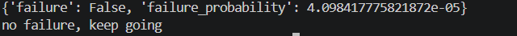
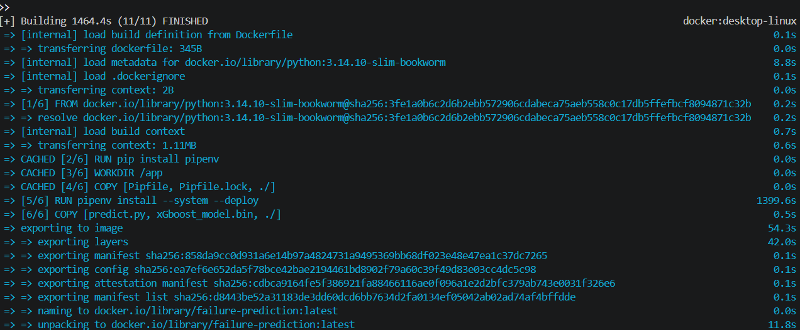

# Failure Detection for Scania Trucks


## Project Overview

This project focuses on predicting failures in the **Air Pressure System (APS)** of heavy-duty Scania trucks. The goal is to identify whether a truck is likely to experience a component failure in its air pressure system based on operational data.

This is a **binary classification problem**. The positive class represents a component failure of the APS system, while the negative class represents failures not related to the APS system.

Accurately detecting potential failures can help reduce unnecessary maintenance costs and, more importantly, prevent costly failures from going unnoticed. Since missing an actual failure is considerably more expensive than raising a false alarm, the project uses a cost-based evaluation metric in addition to ROC AUC.

## Clone the Repository

To get a local copy of this project, clone the GitHub repository:

```bash
git clone https://github.com/szabovargagabi/failure_detection.git
```

## Dataset

The project uses the [APS Failure at Scania Trucks dataset](https://www.kaggle.com/datasets/uciml/aps-failure-at-scania-trucks-data-set/data), available on Kaggle.

The dataset contains two separate files:

- `aps_failure_training_set.csv` – 60,000 records
- `aps_failure_test_set.csv` – 16,000 records

The training set contains approximately 1,000 positive examples, making this a highly imbalanced classification problem.


To run the notebook, download both files from Kaggle and place them in a directory named `data` in the project root:

```text
failure_detection/
│
├── data/
│   ├── aps_failure_training_set.csv
│   └── aps_failure_test_set.csv
│
├── images/
│   └── aps-failure-hero.png
│
├── Dockerfile
├── Pipfile
├── Pipfile.lock
├── README.md
├── notebook.ipynb
├── predict.py
├── predict_test.py
├── train.py
└── xGboost_model.bin
```

## Data Preparation and EDA

The exploratory data analysis and data preparation steps are documented in `notebook.ipynb`. The notebook also contains the model selection and evaluation process.

The main preparation steps were:

1. **Target variable:** The original target column, `class`, was renamed to `failure`. Its values were converted to binary labels (`0` for no failure and `1` for failure).
2. **Missing values:** Missing values were imputed using the mean of the corresponding feature.
3. **Feature selection:** The dataset contains 171 anonymized features. To reduce the number of input variables, features were selected based on their correlation with the target variable. Only features with a correlation greater than `0.2` were retained for model training.

## Model Training

### Model Selection

Because the dataset is highly imbalanced, accuracy alone would not provide a reliable measure of model performance. As a first baseline, a simple Logistic Regression model achieved a ROC AUC score of **0.966**.

Several classification algorithms were then tested and compared:

- Logistic Regression
- Decision Tree
- Random Forest
- XGBoost

The training data was split into training and validation sets. Model performance and hyperparameters were evaluated using the validation data.

### Evaluation Metric: Cost Function

The original problem description proposes evaluating misclassifications with the following cost function:

\[
\text{Cost} = \text{cost}_1 \times FP + \text{cost}_2 \times FN
\]

where:

- `FP` is the number of false positive predictions.
- `FN` is the number of false negative predictions.
- `cost1 = 10`
- `cost2 = 500`

In this problem, a false negative is much more expensive than a false positive. Therefore, minimizing the cost function is more important than optimizing a threshold based only on a conventional classification metric.

### Threshold Selection and Cross-Validation

Since the cost function assigns a much higher penalty to false negatives, the optimal classification threshold is substantially lower than the default value of `0.5`. The threshold was therefore selected by evaluating the cost function across a range of candidate thresholds and choosing the one with the lowest validation cost.

XGBoost achieved the best performance among the evaluated models after hyperparameter tuning. A 3-fold cross-validation procedure was then performed using the tuned XGBoost parameters to determine the number of boosting rounds. The selected number was **195**.

The final threshold selected on the validation set was **0.015**.

### Final Test Results

The selected XGBoost model was trained on the full training dataset and evaluated on the separate test dataset.

| Metric | Result |
|---|---:|
| ROC AUC | **0.996** |
| Cost function | **13,690** |
| Classification threshold | **0.015** |
| Number of boosting rounds | **195** |

## Local Deployment

The final XGBoost training process was moved from the notebook into `train.py`. Running this script trains the model on the full training dataset and saves the trained model as `xGboost_model.bin`. To train and save the model use the following script

```bash
python train.py
```


Start the prediction service locally by running the following command in the project directory:

```bash
waitress --listen=0.0.0.0:9696 predict:app
```

The prediction service will be available on port 9696.

Prediction service running:


To test the Prediction Service open a separate terminal while the prediction service is running and execute:

```bash
python predict_test.py
```

The script sends a test request to the locally running prediction service.

Test result:



## Deployment with Docker

### 1. Train the model

Make sure the training dataset is available in the expected `data` directory, then run:

```bash
python train.py
```

### 2. Build the Docker image

Make sure Docker Desktop is installed and running. Build the image from the project root:

```bash
docker build -t failure-prediction .
```


### 3. Run the Docker container

Start the container and expose the service on port `9696`:

```bash
docker run -it -p 9696:9696 failure-prediction:latest
```

Keep this terminal running while testing the service.

### 4. Test the prediction service

Open a separate terminal and run:

```bash
python predict_test.py
```

This executes the provided test script against the running service. Gives the same results as previously in local deployment. 
